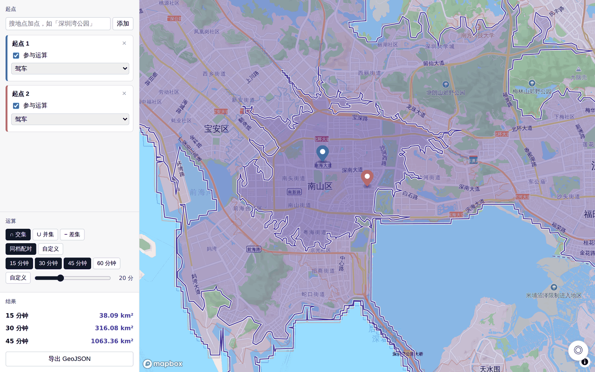
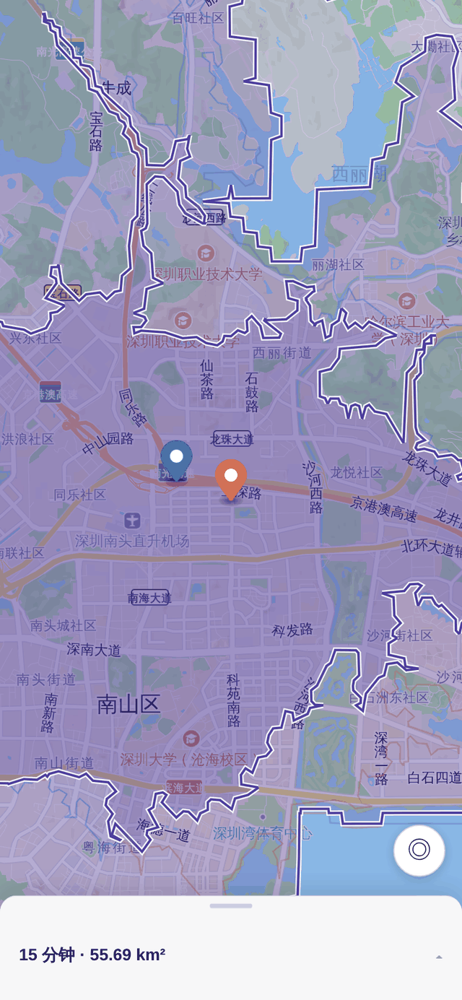

# 🗺️ 等时圈 · 多点可达性交集

<<<<<<< HEAD
**「我们俩 30 分钟内都能到的地方在哪？」** 在地图上标几个起点，答案直接画给你看。
=======
给定多个起点，计算各自的等时圈（驾车 / 驾车实时路况 / 步行 / 骑行 / 公交+步行 / 地铁+步行 / 地铁+骑行），并对它们做交集、并集、差集运算。
>>>>>>> origin/main

**👉 打开就能用：https://raymond1030.github.io/Accessibility-Map/**

不用注册、不用安装，手机电脑都行。

<<<<<<< HEAD
[](https://github.com/Raymond1030/Accessibility-Map/actions/workflows/deploy.yml) [](https://github.com/Raymond1030/Accessibility-Map/actions) [](https://www.mapbox.com/) [](https://zh.wikipedia.org/wiki/%E4%B8%96%E7%95%8C%E5%A4%A7%E5%9C%B0%E6%B5%8B%E9%87%8F%E7%B3%BB%E7%BB%9F) [](LICENSE)
=======
  
>>>>>>> origin/main

长这样 👇 深圳南山两个起点，15 / 30 / 45 分钟驾车都能到的区域层层嵌套：



---

## 💡 它能帮你回答什么

- ☕ **约在哪碰头？** 标上双方位置，看看 30 分钟内都能到的地方
- 🏪 **门店覆盖了哪里？** 几家店的服务范围加起来长什么样
- 🚗 **哪里只有我能到？** A 能到、B 到不了的区域一目了然

<<<<<<< HEAD
每个起点还能单独选出行方式：**驾车 / 驾车（实时路况）/ 步行 / 骑行**——你开车、朋友走路，完全没问题。

## 🚀 怎么用
=======
**1. 公共交通分三条路，各有边界。**

Mapbox Isochrone 只有 driving / driving-traffic / walking / cycling 四个 profile，公共交通组合由两套机制补上：

- **公交+步行、地铁+步行** 走高德 `ArrivalRange`（即 v1 的能力回归，按 mode 分流到第二数据源），需要配置 `VITE_AMAP_KEY`，上限 60 分钟，覆盖范围以高德为准。
- **地铁+骑行** 是自建合成（`src/providers/composite.ts`）：骑行进站圈 → 静态地铁图上多源 Dijkstra → 每个可达车站的骑行出站圈取并集。**目前只覆盖深圳**（线网数据 `src/data/metro/shenzhen.json`，OSM 提取），换乘/班距/进出站用时是估算参数，结果偏保守（剩余时间向下取档）。首刷会发几十上百个腿级请求，靠缓存+抽稀+并发闸门控制，拖动起点后增量很小。
>>>>>>> origin/main

1. **加起点** —— 点一下地图，或搜地名，或点右下角 ◎ 定位到自己
2. **选出行方式** —— 每个点可以不一样
3. **选运算和时间** —— 交集（都能到）、并集（合起来）、差集（只有某点能到），1–60 分钟随便拖
4. **看结果** —— 彩色区域就是答案，左下角有面积，还能导出 GeoJSON

### ⏱️ 时间怎么选

- **同档配对** —— 大家用同一组时间（比如 15 / 30 / 45 分钟），一眼看到层层嵌套的区域，适合「我们多快能碰头」
- **自定义** —— 每个点单独设时间，比如「A 的 15 分钟 ∩ B 的 45 分钟」，适合一方赶路更辛苦的情况

差集要指定一个基准点，结果是「基准点能到、其他点都到不了」的地盘。

### 📱 手机上用



地图全屏，控件收在底部抽屉里，点顶部把手就能展开收起。抽屉收着的时候，结果摘要也一直看得见（右图底部那行「15 分钟 · 55.69 km²」就是）。

手机上加点要先点「**＋ 在地图上加点**」再点地图落点——不然拖个地图就误加一个点，那可太烦了。电脑上直接点地图就行。

<br clear="right">

## 🔍 怎么读结果

**「无共同可达区」不是出 bug 了！** 两个离得很远的点，15 分钟内确实碰不了头——这就是工具想告诉你的结论。想找到共同区域？把时间调大试试。

其他几种提示：

| 提示 | 意思 |
|---|---|
| 🤝 无共同可达区 | 这个时长内真的没交集，调大时间再试 |
| 🌊 周边无可达数据 | 点落在水里或没路的地方了，挪一挪 |
| ⚠️ 数据不全，无法计算 | 某个点数据没取到，会告诉你缺哪个，可以单独重试 |

宁可说「算不了」，也不会拿残缺的数据给你一个看着正常、其实是错的结果。

## 📋 使用前须知

- 🚌 **暂不支持公共交通**，目前只有驾车 / 步行 / 骑行
- 🐢 **国内首次打开要等几秒**（数据来自境外服务），之后就快了；个别地名可能显示英文
- 🗂️ **导出的 GeoJSON 是标准 WGS-84 坐标**，QGIS 等工具直接打开就能用

---

## 🛠️ 开发者

想本地运行、了解架构设计或参与开发？请看 [开发文档](docs/DEVELOPMENT.md)。

React 18 · TypeScript · Mapbox GL JS · Turf.js —— 116 个单元测试全部通过 ✅

<<<<<<< HEAD
基于 [MIT 协议](LICENSE)开源。
=======
| 命令 | 作用 |
|---|---|
| `npm run dev` | 开发服务器 |
| `npm test` | 跑全部单元测试 |
| `npm run typecheck` | 类型检查 |
| `npm run build` | 生产构建（含类型检查） |

## 怎么用

1. 在地图上点击、用搜索框按地名添加，或点右下角的 ◎ 定位到当前位置
2. 每个起点可以单独选出行方式（驾车 / 驾车实时路况 / 步行 / 骑行 / 公交+步行 / 地铁+步行 / 地铁+骑行）
3. 选运算方式和时间档位
4. 结果面积显示在左下角，可导出 GeoJSON

**两种档位模式：**

- **同档配对** — 所有点共用一组档位（如 15/30/45），逐档配对求运算结果，得到嵌套的多层区域。回答「我们多快能碰头」。
- **自定义** — 每个点独立选一个档位，比如 A 的 15 分钟 ∩ B 的 45 分钟。输出单个结果。

差集需要额外指定基准点，语义是 `A \ (B ∪ C ∪ …)`。

### 手机上怎么用

地图全屏，控件收在底部抽屉里。点顶部把手展开或收起——折叠时那一行会一直显示当前的结果摘要，所以收起状态下也能看到交集变化。

加点要先点「＋ 在地图上加点」进入选点模式，再点地图落点。**手机上不能直接点地图加点**：拖动浏览、收起抽屉都会命中地图，而每误加一个点会立刻发出 3 次等时圈请求，额度是实打实烧掉的。进入选点模式时抽屉会自动收起，落点后自动退出模式并保持折叠——加完点你要看的是地图上新出现的等时圈，不是控件。

桌面端行为完全不变，仍是直接点地图加点。

## 空结果是答案，不是错误

这是这个工具最容易被误读的地方，所以专门做了区分：

| 情况 | 界面表现 |
|---|---|
| 交集为空 | 「无共同可达区」——两点在该时长内确实碰不了头，这就是结论 |
| 某点周边无路网 | 「周边无可达数据」——水域、无路区域常见，不阻断其他点的计算 |
| 某点某档请求失败 | 该格单独标红可重试，其余档位照常显示 |
| 该档任一点数据缺失 | 整档标为「数据不全，无法计算」并列出缺哪个点 |

最后一条是关键：**缺数据时绝不用残缺的点集合去算交集**。那会得出一个看起来完全正常、实则错误的结果——比三个点的交集少算一个点，面积只会变大，没有任何异常迹象。

## 架构

```
src/
├─ providers/          ← 唯一知道 Mapbox 存在的地方
│  ├─ mapbox.ts          调用 Isochrone API
│  ├─ mapboxTransform.ts URL 构造、档位匹配、错误映射
│  ├─ cache.ts           参数指纹缓存 + 在飞请求合并
│  ├─ gate.ts            并发闸门（上限 4）+ 指数退避重试
│  ├─ timeout.ts         请求超时保护
│  └─ index.ts           withCache(withGate(withTimeout(provider)))
├─ mapbox/             ← token
├─ geo/                ← 定位；coord.ts 为后续保留
├─ geometry/           ← 纯函数，不碰网络
│  ├─ ops.ts             交集/并集/差集/归一化/简化
│  └─ result.ts          面积格式化、档位可用性判定
├─ state/
│  ├─ compute.ts         请求矩阵规划、档位运算编排
│  └─ store.ts           zustand
└─ components/         ← 单侧栏/底部抽屉 + 全屏地图
```

### 三个不显眼但关键的设计

**Provider 是唯一的数据源接触面。** 它对外只吐标准 GeoJSON。几何层和 UI 层完全不知道数据来自哪里——这层抽象让本项目从高德整体迁到 Mapbox 时，几何、缓存、闸门、编排一行未改。

**档位必须按 `properties.contour` 匹配，不能靠数组下标。** Mapbox 把 features 按档位从大到小返回，用 index 取会拿 15 分钟的下标得到 45 分钟的范围——面积大三倍且毫无异常迹象。

**运算前 simplify 是正确性前提。** 等时圈顶点数多时连续 `intersect` 会阻塞主线程。以约 10 米容差预简化——等时圈本身精度远粗于 10 米，不损失有效信息。

### 请求量与缓存

请求数是 `点数 × 档位数`。缓存的参数指纹形状决定了三件事：

- 切换交集/并集/差集 → **零请求**（纯几何重算）
- 点拖走再拖回原位 → **零请求**
- 给某点新增一个档位 → **只请求那一档**

例外是「驾车（实时路况）」：它的指纹拼入 10 分钟时间桶——同一时段内仍零请求，跨时段重新获取以反映路况变化。所有请求经过并发闸门（同时最多 4 个）+ 超时保护 + 退避重试。

## 测试

```bash
npm test    # 173 个测试
```

测试集中在几何运算层和 provider 转换层——逻辑密度最高、出错最不显眼的地方。全部是纯函数测试，不碰网络。

UI 组件和 `mapbox.ts` 的网络壳没有单元测试：可测逻辑（URL 构造、档位匹配、错误映射、时间桶）全部在纯函数层覆盖，为地图 SDK 搭 mock 的收益低于成本。

### 一条从高德时代留下的教训

v1 用高德时踩过三个只有真实环境能暴露的坑（回调静默不触发、成功却报 no_data、bounds 结构与文档不符——详见 git 历史中的对应提交）。共同教训是：**自己造的 fixture 测不出对接口的错误假设**。因此本版的 `pickContour` fixture 直接取自 Mapbox 真实响应，且超时保护（`withTimeout` 在闸门内层）作为通用防线保留——任何数据源都可能挂死。

## 后续阶段

**组合等时圈打磨。** 地铁+骑行目前只有深圳：其他城市的线网可用 `scripts/build-metro-data.mjs` 从 OSM 生成后按城市分发；区间运行时间/班距可换成实测数据；出站接驳圈可做渐进渲染（先出直达区，接驳圈陆续并入）。

**批量档位请求。** Mapbox 单次请求最多可带 4 个档位，可把请求数从「点数 × 档位数」降到「点数」。当前额度充足（10 万次/月），未做。

## 文档

- v1 设计（高德公交）：`docs/superpowers/specs/2026-08-12-isochrone-tool-design.md`
- 移动端适配：`docs/superpowers/specs/2026-08-12-mobile-adaptation-design.md`
- Mapbox 迁移：`docs/superpowers/specs/2026-08-13-mapbox-migration-design.md`

## 技术栈

React 18 · TypeScript · Vite · Vitest · Turf.js 7 · zustand · Mapbox GL JS 3

> Turf 7 的 `intersect` / `union` / `difference` 接收 `FeatureCollection` 单一参数，与网上大量 Turf 6 示例不兼容。改这部分代码时注意版本。
>>>>>>> origin/main
