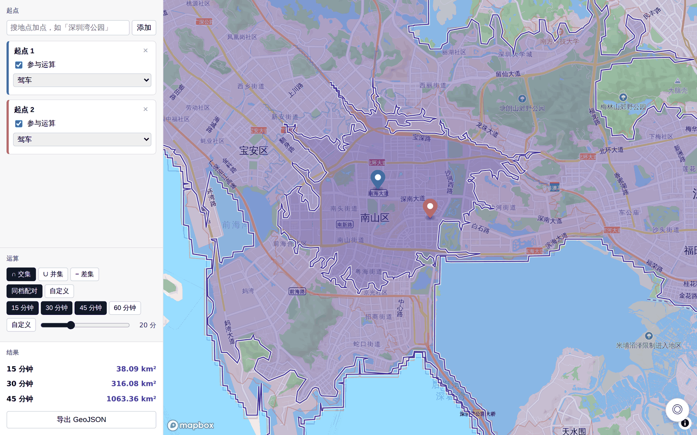
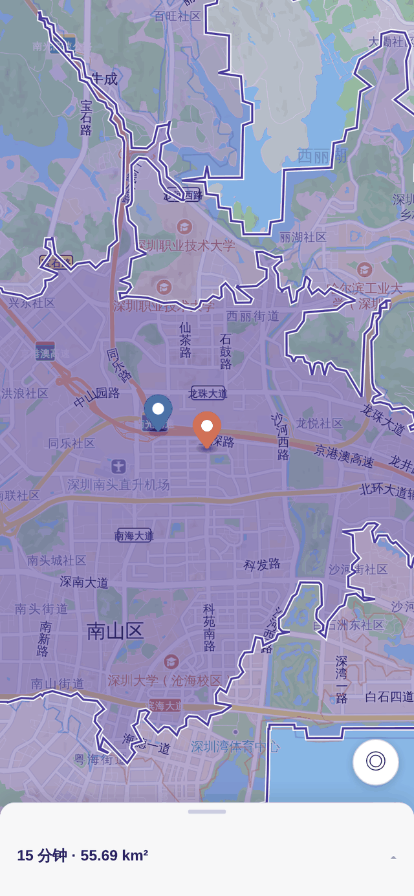

# 🗺️ 等时圈 · 多点可达性交集

**「我们俩 30 分钟内都能到的地方在哪？」** 在地图上标几个起点，答案直接画给你看。

**👉 打开就能用：https://raymond1030.github.io/Accessibility-Map/**

不用注册、不用安装，手机电脑都行。

[](https://github.com/Raymond1030/Accessibility-Map/actions/workflows/deploy.yml) [](https://github.com/Raymond1030/Accessibility-Map/actions) [](https://www.mapbox.com/) [](https://zh.wikipedia.org/wiki/%E4%B8%96%E7%95%8C%E5%A4%A7%E5%9C%B0%E6%B5%8B%E9%87%8F%E7%B3%BB%E7%BB%9F) [](LICENSE)

长这样 👇 深圳南山两个起点，15 / 30 / 45 分钟驾车都能到的区域层层嵌套：



---

## 💡 它能帮你回答什么

- 🏠 **租哪里上班更方便？** 在「租房通勤」中比较候选住处到公司的公交 / 地铁、驾车、步行和骑行路线，按月租预算与单程耗时筛选
- ☕ **约在哪碰头？** 标上双方位置，看看 30 分钟内都能到的地方
- 🏪 **门店覆盖了哪里？** 几家店的服务范围加起来长什么样
- 🚗 **哪里只有我能到？** A 能到、B 到不了的区域一目了然

每个起点还能单独选出行方式：**驾车 / 驾车（实时路况）/ 步行 / 骑行**——你开车、朋友走路，完全没问题。

## 🚀 怎么用

1. **加起点** —— 点一下地图，或搜地名，或点右下角 ◎ 定位到自己
2. **选出行方式** —— 每个点可以不一样
3. **选运算和时间** —— 交集（都能到）、并集（合起来）、差集（只有某点能到），1–60 分钟随便拖
4. **看结果** —— 彩色区域就是答案，左下角有面积，还能导出 GeoJSON

### ⏱️ 时间怎么选

- **同档配对** —— 大家用同一组时间（比如 15 / 30 / 45 分钟），一眼看到层层嵌套的区域，适合「我们多快能碰头」
- **自定义** —— 每个点单独设时间，比如「A 的 15 分钟 ∩ B 的 45 分钟」，适合一方赶路更辛苦的情况

差集要指定一个基准点，结果是「基准点能到、其他点都到不了」的地盘。

### 📱 手机上用



地图全屏，控件收在底部抽屉里，点顶部把手就能展开收起。抽屉收着的时候，结果摘要也一直看得见（右图底部那行「15 分钟 · 55.69 km²」就是）。

手机上加点要先点「**＋ 在地图上加点**」再点地图落点——不然拖个地图就误加一个点，那可太烦了。电脑上直接点地图就行。

<br clear="right">

## 🔍 怎么读结果

**「无共同可达区」不是出 bug 了！** 两个离得很远的点，15 分钟内确实碰不了头——这就是工具想告诉你的结论。想找到共同区域？把时间调大试试。

其他几种提示：

| 提示 | 意思 |
|---|---|
| 🤝 无共同可达区 | 这个时长内真的没交集，调大时间再试 |
| 🌊 周边无可达数据 | 点落在水里或没路的地方了，挪一挪 |
| ⚠️ 数据不全，无法计算 | 某个点数据没取到，会告诉你缺哪个，可以单独重试 |

宁可说「算不了」，也不会拿残缺的数据给你一个看着正常、其实是错的结果。

## 🏠 租房通勤

### 只看工作地周边通勤圈

默认进入「看通勤圈」：只需搜索或在地图标记**工作地**，选择**地铁 / 驾车 / 骑行 / 步行**和 1–60 分钟，点击「生成通勤圈」。不需要添加候选住处或填写租金。地铁包含步行进出站，此入口暂不提供公交。

地图、图例与结果摘要会显示所选方式和时间。修改工作地、方式或时长会清除旧圈，重新生成后显示新结果。手机端可点「查看地图」收起面板。

**地铁已改用自建网络引擎，计算到达工作地的范围**：本地 Dijkstra 计入进出站、平均候车、区间运行和换乘；两端步行各最多 15 分钟，并合并纯步行直达区。Mapbox 提供步行路网轮廓，步行部分按双向可通行近似。地图显示车站与线路名，虚线仅为站间拓扑示意，不是真实轨道轨迹。

目前仅支持深圳静态线网，非实时班次，不计首末班车。线网快照为 2026-08-14，已知 13 号线北延段缺失；覆盖缺口不代表实际不可达。站距估算运行时间，默认班距 5 分钟、进出站各 2 分钟、换乘走行 4 分钟。

**驾车、骑行、步行仍为从工作地出发的参考范围**，使用 Mapbox 等时圈；具体上班方向可在「比较住处」核验。公交等时圈暂不提供，高德 ArrivalRange 已从运行路径和 SDK 插件列表中移除。

### 比较具体住处到公司的路线

切换到「比较住处」可保留工作地，进一步核验上班方向的路线。

1. 顶部切换到「租房通勤」，填写居住城市和工作城市（支持分别填写）。
2. 搜索并确认公司位置，再添加最多 6 个候选小区；也可以在地图上选点。
3. 填写候选住处的月租、预算和单程通勤上限，点击「比较通勤路线」。
4. 对比 **公交 / 地铁、驾车、步行、骑行** 的耗时。选择某个住处或方式查看地图路线、距离和逐段说明；公交还显示具体线路、乘车方向、上下车站、换乘、步行接驳和票价。地图按乘车路段分别配色并标注线路名、上下车站，步行接驳用灰色虚线；深圳地铁使用本地线路配色，其余城市和公交使用行程区分色。
5. 按通勤最快或租金最低排序，或只显示符合当前出行方式及预算的候选住处。

路线方向始终是 **住处 → 公司**。这是你手动添加候选住处的比较工具，不接入房源平台，也不自动获取租金。候选列表保留在本次页面会话中，刷新会清空。耗时是查询时估算，不是固定早高峰预测；驾车未额外计算停车时间。请求失败或缺少租金时会标明原因，不会当作符合条件。

本地需要配置高德 **Web 端 JS API Key**（沿用项目的 `VITE_AMAP_KEY` 和安全配置），无需另加 Web 服务 Key。路线接入说明见 [开发文档](docs/DEVELOPMENT.md#租房通勤的高德接入)。

## 🌿 生活探索与搬家比较

顶部新增「生活探索」，无需先填写公司或候选住处。所有输入、收藏和抽取记录仅在当前页面内保留，刷新清空。

- **生活画像**：搜索或在地图选择起点（也可定位），默认查看步行 15 分钟的商场、理发、超市和公园。可加入便利店、餐饮、咖啡、健身、药店、书店、图书馆、博物馆／展馆，切换四种出行方式及 1–60 分钟。
- **偏好评分**：类别权重为 0–5，0 不参与。每类的选择数量和到达便利程度各占一半，总分按类别权重计算；页面可展开公式。分数基于本次检索样本，每类最多核验 5 个候选，并非全城设施调查。失败类别不会当作零分。
- **周末盲盒**：默认公交／地铁 30 分钟、公园／书店／博物馆类别，每次抽最多 3 个已核验可达的地点。可换一批、收藏、排除或重置抽取记录；不凑数，不重复展示同条件下已抽到的地点。
- **租金买时间**：在「租房通勤 → 比较住处」添加至少两个住处和月租，选择基准、出行方式及月通勤天数（默认 22 天）。分别查询上班与回家方向，比较月租差额、月通勤时间及每省下一小时多付的租金。
- **搬家对比**：比较两个住处的月租、双向通勤、每周常去地点及附近配套。公司默认每周往返 5 次，可另加最多 5 个常去地点，并分别设置城市、方式和往返次数。两处采用相同生活圈设置及类别权重。

点击地点卡片查看地图路线和逐段说明；手机端可收起抽屉查看地图。公交／地铁探索从所选城市周边 50 公里内检索候选，再用高德路线逐点核验，不显示公交等时圈。其余三种方式先用 Mapbox 参考圈检索，再用高德核验具体路线。所有时间均为查询时估算。

## 📋 使用前须知

- 🚌 **租房通勤支持公交 / 地铁**，具体路线使用高德；深圳地铁圈使用静态线网估算，开启下述本地引擎后可计算已导入 GTFS 的公交圈
- 🐢 **国内首次打开要等几秒**（数据来自境外服务），之后就快了；个别地名可能显示英文
- 🗂️ **导出的 GeoJSON 是标准 WGS-84 坐标**，QGIS 等工具直接打开就能用

---

## 🛠️ 开发者

### 本地粤港澳计算引擎

新增可选的 **GraphHopper 本地引擎**：用 OSM 计算广东、香港、澳门的步行、骑行和静态驾车等时圈；导入香港运输署 GTFS 后可计算其覆盖的公共交通等时圈，支持指定出发／到达时刻。香港 feed 不含港铁重铁，深圳地铁仍单独标为静态估算。

```powershell
npm run engine:prepare -- --region guangdong
npm run engine:start -- --region guangdong
# 另开终端
npm run dev:local
```

需要 JDK 17+、Python 3.8+ 和 Node 18+。本地路由无需在线路由 Key；底图、搜索和既有点到点路线比较沿用原配置。普通启动及线上页面保持原数据源。

[方法与数据来源](docs/LOCAL_ENGINE_METHOD.md) · [运行、更新与导入说明](docs/LOCAL_ENGINE_RUNBOOK.md) · [真实验收记录](docs/LOCAL_ENGINE_VALIDATION.md) · [计算流程图](docs/assets/local-engine-flow.png)

想本地运行、了解架构设计或参与开发？请看 [开发文档](docs/DEVELOPMENT.md)。

React 18 · TypeScript · Mapbox GL JS · Turf.js —— 测试使用 `npm test` 运行

基于 [MIT 协议](LICENSE)开源。
