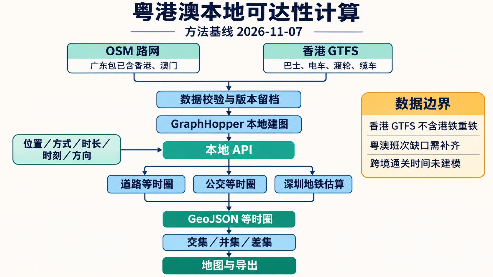
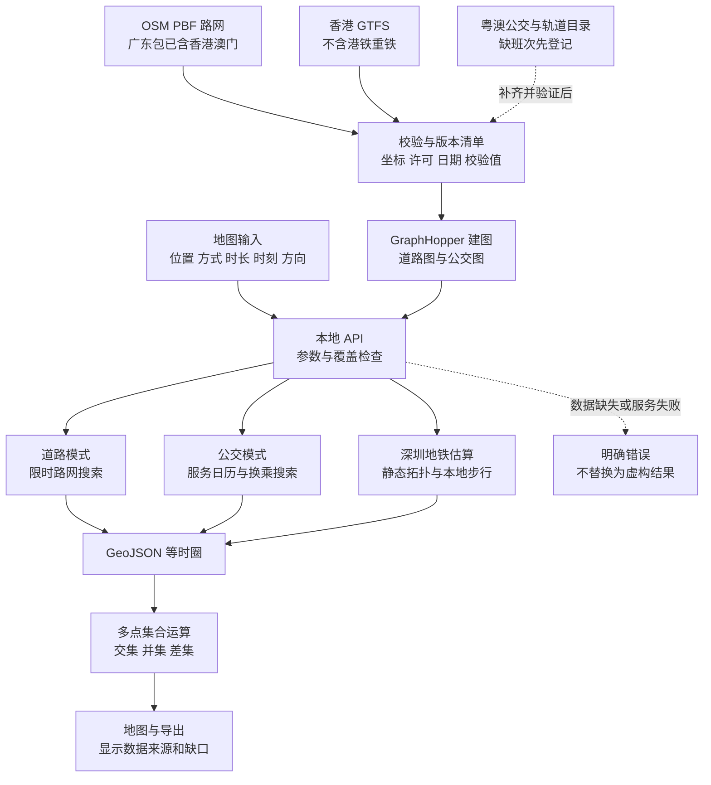

# 粤港澳本地可达性引擎方法说明

记录日期：2026-11-07。状态：实施前的方法基线；实际运行记录另存，不能以本文件替代验收结果。

本项目计算“从一个地点出发，或在给定时间内到达一个地点，可以覆盖哪些地方”。采用 GraphHopper 11.0 在本机读取 OpenStreetMap 路网与 GTFS 公共交通数据，由现有 React 地图展示等时圈、交集、并集和差集。数据准备后，路由计算无需 Mapbox 或高德路由 API；底图、地址搜索和现有点到点通勤比较仍是独立功能。

## 1 选型与边界

| 方案 | 适用任务 | 本次取舍 |
| --- | --- | --- |
| GraphHopper 11.0 | 道路路由、路网等时圈、GTFS 公交等时圈 | 采用。已有 Java 17 可直接运行；同一服务支持道路与公交接口 |
| OpenTripPlanner 2 | 多模式行程规划、公交实时信息 | 本次不采用。2.6 移除了旧 TravelTime API，旧教程中的等时圈接口不能直接用于当前版本 |
| R5 / r5py | 批量出行时间矩阵、研究型可达性分析 | 后续批量分析候选；当前 Windows 环境需要补充 Python 地理计算依赖和 Java 21 |

GraphHopper 固定为 11.0，下载后验证发布包的 SHA-256。运行时只绑定本机地址。项目保留现有界面，通过可配置 provider 接入本地服务；未开启本地模式时保留既有配置。

来源：[GraphHopper 项目](https://github.com/graphhopper/graphhopper)、[公交使用说明](https://github.com/graphhopper/graphhopper/blob/11.0/reader-gtfs/README.md)、[公交等时圈实现](https://github.com/graphhopper/graphhopper/blob/11.0/web-bundle/src/main/java/com/graphhopper/resources/PtIsochroneResource.java)、[OTP 更新记录](https://docs.opentripplanner.org/en/latest/Changelog/)、[r5py 安装说明](https://r5py.readthedocs.io/latest/user-guide/installation/installation.html)。

## 2 数据清单与覆盖

| 地区或数据 | 来源与格式 | 能支持的计算 | 缺口与处理 |
| --- | --- | --- | --- |
| 广东省，含香港、澳门 | [Geofabrik 广东 OSM](https://download.geofabrik.de/asia/china/guangdong.html)，PBF，页面约 166 MB | 三地步行、骑行、驾车路网 | 广东包已包含港澳，合建时只使用此包，避免重叠导入 |
| 香港独立路网 | [Geofabrik 香港 OSM](https://download.geofabrik.de/asia/china/hong-kong.html)，PBF，约 36 MB | 小规模香港样例与公交步行接驳 | 与广东包二选一 |
| 澳门独立路网 | [Geofabrik 澳门 OSM](https://download.geofabrik.de/asia/china/macau.html)，PBF，约 2.8 MB | 低内存路网验证样例 | 与广东包二选一；没有 GTFS 不显示为公交计算 |
| 香港公交班次 | [运输署公共交通服务班次资料](https://data.gov.hk/en-data/dataset/hk-td-tis_11-pt-headway-en)，[GTFS ZIP](https://static.data.gov.hk/td/pt-headway-en/gtfs.zip) | 步行接驳与该 feed 已覆盖的公交线路 | 实测 routes.txt 有类型 0、3、4、7；不含类型 1、2，不能宣称含港铁重铁 |
| 香港港铁 | [港铁实时列车数据](https://data.gov.hk/en-data/dataset/mtr-data2-nexttrain-data/resource/103472ed-01be-4dda-92c6-30530dee022f)及运营方开放资料 | 后续补充站点、线路及短时实时信息 | “未来四班车”接口不是可任意选日期计算的完整 GTFS，不直接冒充静态时刻表 |
| 深圳地铁 | 项目已有 `src/data/metro/shenzhen.json`，来源为 OSM 线路关系 | 站点拓扑和平均班距下的地铁估算；接驳改用本地步行路网 | 快照 2026-08-14；有已知缺线，非实时、不计首末班车；当前只覆盖深圳 |
| 深圳官方地铁目录 | [深圳地铁线路信息](https://opendata.sz.gov.cn/data/dataSet/toDataDetails/29200_63800001)，XLSX 等 | 用于核对线路与站点 | 目录不是完整 GTFS；下载资格、坐标及字段需逐一核验 |
| 深圳官方公交目录 | [深圳公交线路、站点一览表](https://www.sz.gov.cn/xxgk/sydwxxgk/jt/gj/ywxx/gjlx/content/post_12601256.html) | 后续线路核验、转换材料 | 不能只凭首末班时间合成逐站真实时刻表 |
| 澳门巴士 | [澳门交通事务局巴士路线资料](https://data.gov.mo/Detail?id=e7b2e84d-3333-42f0-b676-64ce95306f0d)，SHP、XLS | 站点、路线几何及站序核验 | 未确认可直接导入的完整 GTFS；需补班次、服务日期与逐站运行时间 |
| 中国公交与地铁研究数据 | [CPTOND-2025 论文](https://pmc.ncbi.nlm.nih.gov/articles/PMC12886901/)，[数据仓库](https://doi.org/10.6084/m9.figshare.29377427) | 广东各城市站点与线路研究候选 | 几何网络不等于时刻表；引用及再分发条件应按数据仓库核验 |

本次检索未核实到覆盖广东全省及澳门的、可无凭证直接下载并立即用于班次规划的完整 GTFS。该结论是本次核验状态，不代表这些地区没有相关数据。目录型资料保留入口和格式，不伪造班次补齐。

OSM 使用 ODbL，应用与导出保留 OpenStreetMap contributors 及数据提取方署名。政府开放数据按各来源条款保留署名；“可下载”“开放数据”和“软件开源”不是同一个概念。

## 3 数据准备方法

1. 选择 `guangdong`、`hong-kong` 或 `macau` 路网配置。默认广东配置覆盖三地；小样本验证可先用澳门。
2. 下载版本固定的 GraphHopper JAR 和选定 PBF。下载写入临时文件，成功校验后再替换正式文件，避免半包用于建图。
3. 香港或广东配置可加入香港 GTFS。检查 ZIP 内容、必要文件、站点坐标、route_type、calendar 与 calendar_dates、服务日期和频率信息。为手工提供的 GTFS 保留导入入口。
4. 记录来源 URL、获取时间、文件字节数与 SHA-256，生成机器可读清单。OSM 另核对来源提供的校验值。
5. 每种区域、数据版本使用对应图目录。更新原始数据后显式重建，不能把“新清单”贴在“旧图”上。
6. 默认保留步道、楼梯、自行车道及道路；按 OSM access、单行和模式限制建图。路网与站点统一使用 WGS-84，不能把 GCJ-02 坐标直接混入。

## 4 计算方法

### 4.1 道路等时圈

输入为起点经纬度、出行模式、时间上限和方向。经纬度在项目 API 中使用 `[经度, 纬度]`，GraphHopper 的 point 参数使用 `纬度,经度`，适配层必须交换顺序。分钟在接口边界转换为秒。

将起点吸附到该模式可通行的路网，计算受时间限制的最短路径树，再将可达网络转成 Polygon 或 MultiPolygon。驾车使用速度与方向信息；步行和骑行采用各自通行与速度模型。等时圈几何是网络结果的插值表示，海岸、水面、稀疏路网附近不能解释为内部每一平方米都可达。

方向分为从起点出发和向终点到达。到达圈通过反向遍历计算，不能把出发圈直接改名为到达圈。静态驾车不包含实时拥堵、停车寻找或实际口岸通关等待。

### 4.2 GTFS 公交等时圈

指定带时区的出发或到达时刻。GraphHopper 将步行网络与 GTFS 站点、班次和服务日历连接，在时间相关网络中搜索，计入步行、候车、乘车和换乘。频率型服务是班距模型，其等待时间假设须根据引擎与 feed 的处理说明解读，不能当作车辆真实到站预报。

使用 `/isochrone-pt`，设置 `pt.earliest_departure_time`、`time_limit` 和 `reverse_flow`；由适配层统一请求与错误。公交服务日历使用 feed 时区；跨午夜的 `24:xx:xx` 归属原服务日，交由 GTFS 引擎处理。

没有可用 feed、查询日期不适用或查询点不在已声明公交覆盖内时，明确返回数据缺口。不能把仅步行结果包装成“当地全部公交均不可达”。香港 feed 的港铁缺口应在选择公交时持续可见。

### 4.3 深圳静态地铁估算

保留项目现有地铁 Dijkstra 及其公开假设：平均班距 5 分钟、进出站各 2 分钟、换乘走行 4 分钟、两端步行各最多 15 分钟。区间运行时间仍按站距估算。仅把接驳所需的 Mapbox 步行圈替换为 GraphHopper 步行圈。

这一模式单独标记为“深圳地铁估算”，不与香港 GTFS 的数据等级混淆，也不宣称已获得广东全省、香港港铁或澳门轻轨的真实时刻表。

### 4.4 多点运算

每个起点先独立获得同档位等时圈，再由现有 Turf 模块计算交集、并集或差集。一个必要输入失败时，整体显示数据不全；合法空结果与服务故障分别处理。公交缓存必须包含查询时刻、方向及数据版本，防止把不同班次条件的结果混用。

## 5 系统流程

流程图图片由用户指定的 imagegen 生成；可编辑结构保存在 [local-engine-flow.mmd](assets/local-engine-flow.mmd)。图片是方法示意，接口名称、参数和覆盖声明以本文及实现为准。

## 6 本地接口与运行约定

| 接口或命令 | 作用 |
| --- | --- |
| 数据准备命令 | 下载、校验、GTFS 检查并生成配置与数据清单 |
| 本地启动命令 | 启动 GraphHopper 与本地适配服务；首次运行建图 |
| `GET /health` | 区分引擎未就绪、已就绪与数据缺失，返回区域和数据版本 |
| `GET /sources` | 数据来源、交通方式覆盖及缺口 |
| `POST /isochrone` | 接受经纬度、方式、分钟、时刻、方向，返回 GeoJSON |
| `VITE_LOCAL_ENGINE_URL` | 前端启用本地 provider 的入口 |

本地引擎监听地址不对外网开放。静态 GitHub Pages 不能替用户运行 Java 服务；本地启动地图和引擎是主要使用方式。大文件、图缓存和日志放在被 Git 忽略的目录，源码、方法、配置和验收报告进入项目留档。

## 7 验收标准

1. 在真实 PBF 上成功建图，至少用广东、香港、澳门的代表坐标验证道路计算；不能只用模拟响应证明可运行。
2. 香港公交使用实际下载 GTFS，核验文件类型、服务日期和站点接驳；记录真实等时圈响应及耗时。未通过时如实标记。
3. 验证经纬度顺序、分钟秒数转换、出发与到达方向、公交日期及缓存隔离。
4. 错误输入、超时、引擎关闭、无覆盖和数据缺口可区分，无静默切回外部服务。
5. 保留既有 UI 改动；运行前端测试、类型检查和构建，并报告原有环境问题。
6. 留存一条可复现查询、响应 GeoJSON、数据清单和运行日志摘要。记录引擎版本与文件哈希，支持以后重跑对比。

## 8 已知约束与后续补齐

当前机器为 Windows，物理内存约 16 GB，检查时空闲不足 2 GB。先用小区域验证启动，再控制 Java 堆和建图并发；省级图是否可常驻以实测为准，不预先承诺性能。

跨境道路或线路存在不代表可直接跨境通勤。口岸开放时段、证件限制、通关等待和特定车辆限制没有被完整建模；跨境结果只能作为网络连通参考。澳门轻轨、香港港铁、广东各城市公交的可靠班次数据是后续独立补齐项，不能用统一假设生成后标为官方数据。
